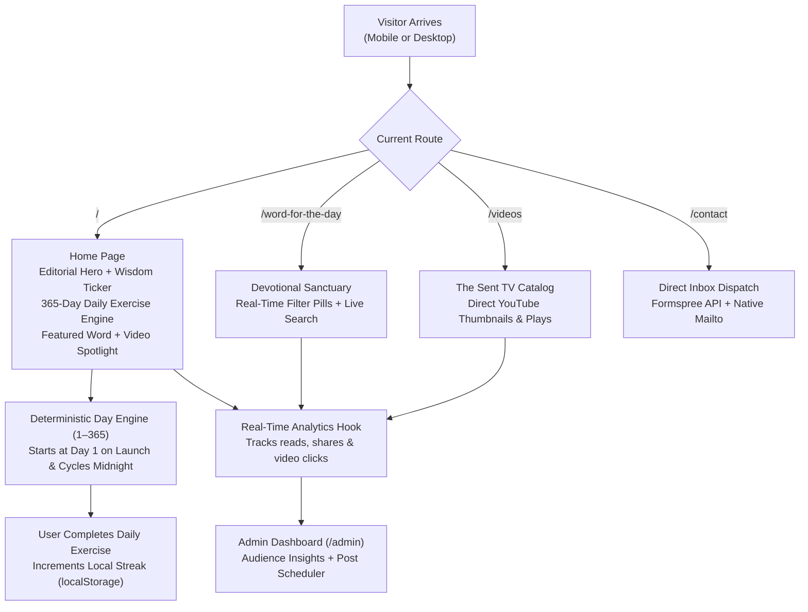

# Graced Relationship Recipes

**Biblical relationship wisdom, daily devotionals, and evangelical media platform, built with React and Vite.**


> *"And over all these virtues put on love, which binds them all together in perfect unity."* — Colossians 3:14

**Built for The Sent TV.** Graced Relationship Recipes is the digital platform for **Anuoluwapo Oluwagbayela Serah** (Chartered Accountant, entrepreneur, and drama minister), bridging faith-based video productions, purpose-driven counseling, and daily spiritual habit-building.

---

## The problem and who it is for

**Users:** Christian singles preparing for courtship, courting couples, married partners, and youths seeking purpose-driven relationships.

Navigating modern relationships often leaves individuals overwhelmed by worldly advice, emotional burnout, and superficial dating culture that ignores God's structural design. The original **Grace Relationship Recipes** ministry began as a Blogger archive of faithful devotionals, but lacked interactive engagement, mobile habit-tracking, integrated video streaming, and automated content scheduling.

**Graced Relationship Recipes** revamps the entire ministry into a full-stack, local-first web sanctuary designed to anchor hearts in covenant grace.

---

## What Graced Relationship Recipes does

Visitors enter an editorial, distraction-free sanctuary with three core pillars:

1. **Word for the Day Sanctuary** — Curated, multi-paragraph biblical reflections (*True Love*, *Helpmeet*, *Chastity*, and *Called Back From Grief*) with verified chapter & verse callouts, live text search, topic filtering, and **1-click WhatsApp scripture sharing**.
2. **Automated 365-Day Daily Exercise & Streak Engine** — An interactive growth room that rotates automatically every single calendar day of the year (Day 1 through Day 365) with interactive letter tiles (Word Unscrambles), Wisdom Quizzes with biblical explanations, and Scripture Memory challenges. It tracks consecutive daily visits with local device streak counters (`🔥 7-Day Streak`).
3. **The Sent TV Video Ministry** — Video library integrating Anuoluwapo's YouTube teachings (*RB Splash - Fathers*, *Things to Discuss in Courtship*, *Inner Beauty*, *Honourable Wedding*) with genuine YouTube video thumbnails, duration badges, and direct channel subscriptions.

---

## How it works under the hood



The 365-day exercise rotation requires **zero ongoing maintenance**:

```javascript
// Deterministic calendar launch anchor (Day 1 at launch, cycles midnight)
const diffDays = Math.floor((currentMidnight - LAUNCH_DATE_MS) / 86400000);
const todaysExercise = dailyExercises[Math.max(0, diffDays) % 365];
```

---

## Platform features and capabilities

| Module | Feature | Implementation | Notes |
| :--- | :--- | :--- | :--- |
| **Devotionals** | Word for the Day | React Router v7 + LocalStorage | Full line break & paragraph preservation with WhatsApp copy |
| **Daily Game** | 365-Day Habit Builder | Deterministic Day-of-Year Engine | Word unscramble, wisdom quiz, and scripture memory |
| **Habit Streaks** | Visitor Streak Tracker | `StreakContext` + Browser Storage | Zero sign-up required; tracks consecutive day visits |
| **Video Center** | The Sent TV Integration | YouTube oEmbed & Thumbnails | Clicks tracked in live admin analytics |
| **Contact** | Direct Inbox Dispatch | Formspree API + Native Mailto | Delivers directly to `sentannie@gmail.com` |
| **Admin Portal** | Private Management | `/admin` (Stealth Route) | No public admin buttons on the user-facing site |
| **Post Scheduler** | Queue for the Week | Future ISO Date Filter | Posts remain hidden until the scheduled release time |
| **Bible Lookup** | ⚡ Auto-Fetch Scripture | Free Bible API Integration | Looks up KJV, WEB, and BBE verses in real time |
| **Cover Media** | Image Options | FileReader (Device) + Presets | Upload phone graphics or select curated relationship photos |

---

## Repository layout

```text
graced-relationship-recipes/
├── docs/                  # PRD and client handover walkthrough
├── public/                # Static assets, official portrait, SPA redirects
├── src/
│   ├── components/        # Reusable UI (Navbar, Footer, 365 Exercise Card, VideoCard)
│   ├── context/           # State providers (AuthContext, DataContext, StreakContext)
│   ├── data/              # 365 daily exercises bank & curated devotionals
│   ├── pages/             # Public sanctuary routes (Home, Word, Videos, About, Contact)
│   │   └── admin/         # Private CMS (Overview, Posts Scheduler, Analytics, Settings)
│   ├── App.jsx            # Route definitions & layout wrappers
│   └── index.css          # Design system, CSS variables & typography tokens
├── vercel.json            # Vercel SPA rewrite configuration
├── vite.config.js         # Vite bundler configuration
└── README.md              # Project documentation
```

---

## Reproducible local setup (about 2 minutes)

Prerequisites: **Node.js 18+** and **npm 9+**.

```bash
# 1) Clone repository
git clone https://github.com/YOUR_USERNAME/graced-relationship-recipes.git
cd graced-relationship-recipes

# 2) Install dependencies
npm install

# 3) Start local development server
npm run dev
```

Visit `http://localhost:5173/` in your browser.

```bash
# 4) Build production bundle
npm run build
```

---

## Administrator access and credentials

The private administration portal is accessible directly via URL:

| Field | Value |
| :--- | :--- |
| **Admin URL** | `http://localhost:5173/admin/login` |
| **Email** | `sentannie@gmail.com` *(or `admin@gracedrelationships.com`)* |
| **Access Level** | Full CMS: Create, Schedule, Edit, Delete, Analytics |

> [!NOTE]
> There are no public "Admin Login" buttons visible on the user-facing website. The admin portal is kept private and accessible solely via direct URL.

---

## Engineering and ministry attribution

* **Visionary & Author:** **Anuoluwapo Oluwagbayela Serah**  
  *Chartered Accountant, Entrepreneur, Drama Minister, and Founder of The Sent TV.*  
  *YouTube:* [@THESENT_TV](https://www.youtube.com/@THESENT_TV) • *Email:* `sentannie@gmail.com` • *Location:* Lagos, Nigeria.

* **Lead Software Engineer:** **Oluwanifemi Peace Ojewusi** (`Peaceyy28`)  
  *Email:* `oluwanifemipeace3@gmail.com`

---

## License

This project is licensed under the [MIT License](LICENSE).
