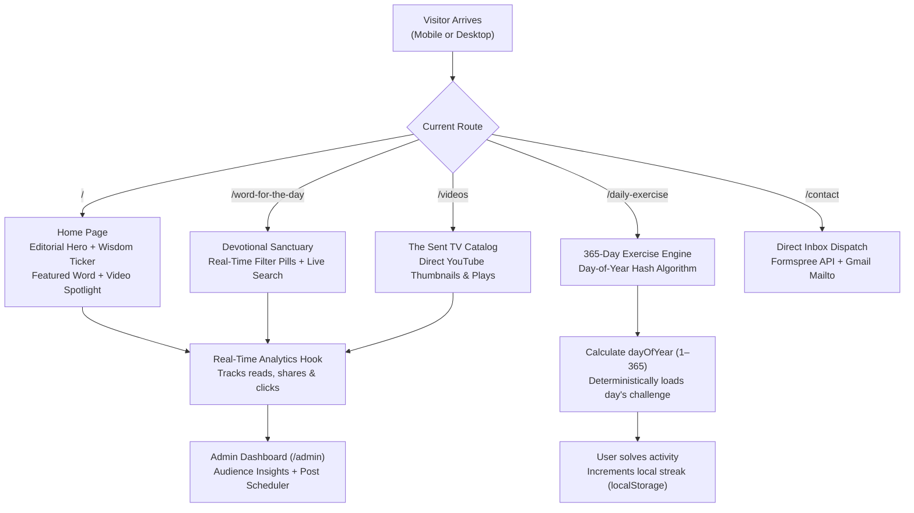

# Graced Relationship Recipes

**Biblical relationship wisdom, daily devotionals, and evangelical media platform, built with React and Vite.**


> *"And over all these virtues put on love, which binds them all together in perfect unity."* — Colossians 3:14

**Built for The Sent TV.** Graced Relationship Recipes is the digital platform for **Anuoluwapo Oluwagbayela Serah** (Chartered Accountant, entrepreneur, and drama minister), bridging evangelical media productions, purpose-driven counseling, and daily spiritual habit-building.

---

## The Problem and Who It Is For

**Audience:** Christian singles, courting couples, married partners, and youths seeking purpose-driven relationships.

Navigating modern relationships often leaves individuals overwhelmed by worldly advice, emotional burnout, and superficial dating trends that ignore God's blueprint. The original **Grace Relationship Recipes** ministry began as a Blogger archive of faithful devotionals, but lacked interactive engagement, mobile habit-tracking, integrated video streaming, and automated content scheduling.

**Graced Relationship Recipes** revamps the entire ministry into a full-stack, local-first web sanctuary designed to anchor hearts in covenant grace.

---

## What Graced Relationship Recipes Does

Visitors enter an editorial, distraction-free sanctuary with three core pillars:

1. **Word for the Day Sanctuary** — Curated, multi-paragraph biblical reflections (*True Love*, *Helpmeet*, *Chastity*, and *Called Back From Grief*) with verified chapter & verse callouts, live text search, topic filtering, and **1-click WhatsApp scripture sharing**.
2. **Automated 365-Day Daily Exercise & Streak Engine** — An interactive growth room that rotates automatically every single calendar day of the year (Day 1 through Day 365) with interactive letter tiles (Word Unscrambles), Wisdom Quizzes with biblical explanations, and Scripture Memory challenges. It tracks consecutive daily visits with local device streak counters (`🔥 7-Day Streak`).
3. **The Sent TV Video Ministry** — Video library integrating Anuoluwapo's YouTube teachings (*RB Splash - Fathers*, *Things to Discuss in Courtship*, *Inner Beauty*, *Honourable Wedding*) with genuine YouTube video thumbnails, duration badges, and direct channel subscriptions.

---

## How It Works Under The Hood



The 365-day exercise rotation requires **zero ongoing maintenance**:
```javascript
// Deterministic calendar day mapping (1–365)
const dayOfYear = Math.floor((today - startOfYear) / 86400000);
const todaysExercise = dailyExercises[dayOfYear % 365];
```

---

## Platform Features & Capabilities

| Module | Feature | Implementation | Notes |
| :--- | :--- | :--- | :--- |
| **Devotionals** | Word for the Day | React Router v7 + LocalStorage | Full line break & paragraph preservation with WhatsApp copy |
| **Daily Game** | 365-Day Habit Builder | Deterministic Day-of-Year Engine | Word unscramble, wisdom quiz, and scripture memory |
| **Habit Streaks** | Visitor Streak Tracker | `StreakContext` + Browser Storage | Zero sign-up required; tracks consecutive day visits |
| **Video Center** | The Sent TV Integration | YouTube oEmbed & Thumbnails | Clicks tracked in live admin analytics |
| **Contact** | Direct Inbox Dispatch | Formspree API + Native Mailto | Delivers directly to `sentannie@gmail.com` |
| **Admin Portal** | Private Management | `/admin` (Stealth Route) | No public admin buttons on the user-facing site |
| **Post Scheduler** | Queue for the Week | Future ISO Date Filter | Posts remain hidden until the scheduled release time |
| **Bible Lookup** | ⚡ Auto-Fetch Scripture | Free Bible API Integration | Looks up KJV, WEB, and BBE verses in real time |
| **Cover Media** | Image Options | FileReader (Device) + Presets | Upload phone graphics or select curated relationship photos |

---

## Project Structure

```text
graced-relationship-recipes/
├── docs/                      # Architectural specs & client guides
│   ├── PRD.md                 # Product Requirements Document
│   └── CLIENT_GUIDE.md        # Client feature walkthrough
├── public/                    # Production static assets
│   ├── _redirects             # Netlify SPA redirect configuration
│   ├── anuoluwapo.jpeg        # Official portrait of Anuoluwapo
│   └── favicon.svg            # Custom royal heart favicon
├── src/
│   ├── components/            # Reusable interface components
│   │   ├── DailyExerciseCard.jsx  # Interactive 365-day exercise card
│   │   ├── Footer.jsx             # Site footer with Colossians 3:14 quote
│   │   ├── Navbar.jsx             # Frosted glass responsive header
│   │   ├── VideoCard.jsx          # The Sent TV YouTube card
│   │   ├── WisdomTicker.jsx       # Continuous animated scripture ribbon
│   │   ├── WordCard.jsx           # Devotional card with WhatsApp copy
│   │   └── YoutubeIcon.jsx        # Standalone SVG brand icon
│   ├── context/               # Global state providers
│   │   ├── AuthContext.jsx        # Admin session management & credentials
│   │   ├── DataContext.jsx        # Devotionals, videos, analytics & scheduler
│   │   └── StreakContext.jsx      # Visitor daily streak persistence
│   ├── data/                  # Static data & exercise banks
│   │   ├── dailyExercises.js      # Full 365-day exercise library
│   │   └── initialData.js         # Real devotionals, videos & settings
│   ├── pages/                 # Public route views
│   │   ├── About.jsx              # Founder bio & ministry pillars
│   │   ├── Contact.jsx            # Contact form with direct inbox delivery
│   │   ├── DailyExercisePage.jsx  # Dedicated game room
│   │   ├── Home.jsx               # Asymmetric editorial hero & features
│   │   ├── Videos.jsx             # The Sent TV video directory
│   │   ├── WordDetail.jsx         # Full reading sanctuary view
│   │   ├── WordForTheDay.jsx      # Devotional repository & search
│   │   └── admin/                 # Private Content Management System
│   │       ├── AdminAnalytics.jsx # Live audience metrics & discovery
│   │       ├── AdminLayout.jsx    # Sidebar with mobile drawer toggle
│   │       ├── AdminLogin.jsx     # Strict admin authentication
│   │       ├── AdminOverview.jsx  # Dashboard metrics & quick actions
│   │       ├── AdminPosts.jsx     # Post editor, scheduler & Bible fetch
│   │       ├── AdminSettings.jsx  # Ministry metadata & contact config
│   │       └── AdminVideos.jsx    # Video curation & YouTube manager
│   ├── App.jsx                # Application routes & layout bindings
│   ├── index.css              # Editorial theme variables, fonts & tokens
│   └── main.jsx               # Application entry point
├── vercel.json                # Vercel SPA rewrite configuration
├── vite.config.js             # Vite configuration
└── README.md                  # Project documentation
```

---

## Reproducible Local Setup (about 2 minutes)

Prerequisites: **Node.js 18+** and **npm 9+**.

```bash
# 1) Clone repository
git clone https://github.com/YOUR_USERNAME/graced-relationship-recipes.git
cd graced-relationship-recipes

# 2) Install dependencies
npm install

# 3) Start local development server
npm run dev
```

Visit `http://localhost:5173/` in your browser.

```bash
# 4) Build production bundle
npm run build
```

---

## Administrator Access & Credentials

The private administration portal is accessible directly via URL:

| Field | Value |
| :--- | :--- |
| **Admin URL** | `http://localhost:5173/admin/login` |
| **Email** | `sentannie@gmail.com` *(or `admin@gracedrelationships.com`)* |
| **Password** | `graced2026` |
| **Access Level** | Full CMS: Create, Schedule, Edit, Delete, Analytics |

> [!NOTE]
> There are no public "Admin Login" buttons visible on the user-facing website. The admin portal is kept private and accessible solely via direct URL.

---

## Ministry Attribution & Engineering Credits

* **Visionary & Author:** **Anuoluwapo Oluwagbayela Serah**  
  *Chartered Accountant, Entrepreneur, Drama Minister, and Founder of The Sent TV.*  
  *YouTube:* [@THESENT_TV](https://www.youtube.com/@THESENT_TV) • *Email:* `sentannie@gmail.com` • *Location:* Lagos, Nigeria.

* **Lead Software Engineer:** **Oluwanifemi Peace Ojewusi** (`Peaceyy28`)  
  *Email:* `oluwanifemipeace3@gmail.com`

---

## License

This project is licensed under the [MIT License](LICENSE).
